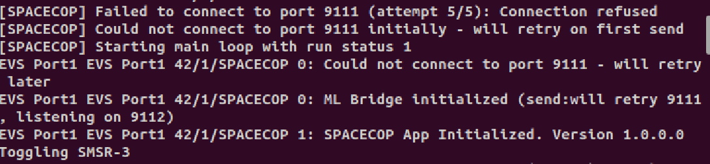
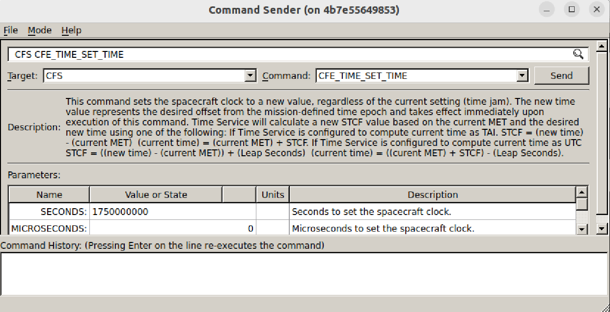
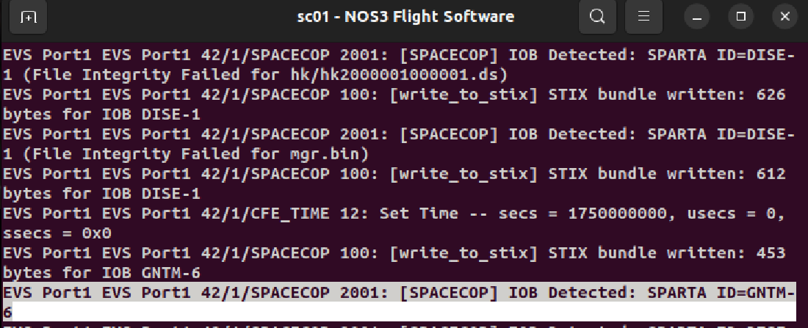

# Scenario - SpaceCOP

This scenario was designed to utlize the open source Intrusion Detection System SpaceCOP from the Aerospace Coperation. The SpaceCOP IDS can be utlized to help prove out Space Attack Research and Tactic Analysis (SPARTA) Techniques for demonstration purposes for cybersecurity research. More about SPARTA can be found here: https://sparta.aerospace.org/

Below is a description of SpaceCOP from their Github found here: https://github.com/the-aerospace-corporation/spacecop-ce

SpaceCOP is an onboard intrusion detection system (IDS) for spacecraft funded by the Department of Homeland Security (DHS) Science and Technology Directorate (S&T). It runs as a cFS flight application and continuously monitors the vehicle for signs of compromise — watching system calls, file integrity, memory, and the commands sent up from the ground — and flagging behavior that matches known threats.

Detections are expressed as rules mapped to SPARTA IOBs (Indicators of Behavior), so operators can describe attacker techniques in a standard vocabulary rather than hand-coding one-off checks. Threat intelligence can be delivered to the spacecraft as STIX-formatted CTI reports, and an optional machine-learning component (SpaceCOP ML) adds anomaly detection trained on the vehicle's own telemetry. Alerts surface through the OpenC3/COSMOS ground software so operators can respond in near real time.

## Learning Goals

By the end of this scenario, you should be able to:
* Learn about SPARTA IOBs
* Enable the SpaceCOP IDS
* Detect an IOB with the IDS via spacecraft TLM.
All this while the spacecraft is in a simulated orbit.

## Prerequisites

Before running the scenario, complete the following steps:
* [Getting Started](./NOS3_Getting_Started.md)
  * [Installation](./NOS3_Getting_Started.md#installation)
  * [Running](./NOS3_Getting_Started.md#running)
* It is assumed for this scenario that the user understands how to command the Spacecraft and verify telemetry with COSMOS.

## Walkthrough
This scenario will enable SpaceCOP as a cFS FSW application. To do so we will need to first utlize the Research configuration.

In `/nos3/cfg/nos3-mission.xml` change to the research configuration as seen below:
```
<sc-1-cfg>spacecraft/sc-research-config.xml</sc-1-cfg>
```
Then run a `make clean` and `make` to rebuild the NOS3 system for the research configuration which will enable the SpaceCOP cFS App.

Launch NOS3 with `make launch` command. Note, in the cFS terminal you should see the SpaceCOP app initialize in the FSW terminal:



Next, we will send a **Time Set** command through the **CFE** app. Open COSMOS and verify the cmd_tlm_server is running. Then send the command pictured below through the command sender. This will set cFS time to a point in the future so SpaceCOP can detect the time change.



Finally, verify that Spacecop detected the time change and mapped it to the appropriate IOB **GNTM-6**. See below for the EVS message that should appear in the FSW terminal when you send the above Time Set command.



This IOB detected is mapped to the SPARTA IOBs documented here for a full description: https://sparta.aerospace.org/related-work/iob/GNTM-6

The full list of IOBs documented by the Aerospace Coperation can be found here: https://sparta.aerospace.org/related-work/iob

The user can now utlize NOS3 and SPARTA to detect IOBs documented.


## The Future with SpaceCOP and NOS3

Note, there are some limitations in NOS3 and IOB detection with SpaceCOP in the simulated environment. Specifically related to running cFS with Docker. These limitations are documented here: [NOS3 SpaceCOP Limitations](NOS3_SpaceCOP_Limitations.md)

The NOS3 team plans to address these current limitations by creating a NOS3 configuration tailored specifically for SpaceCOP. This configuration will be implemented in a future release with NOS3.

## Conclusions

The user now has learned about SPARTA, and is now able to utlize the SpaceCOP IDS in NOS3 to detect IOBs.


